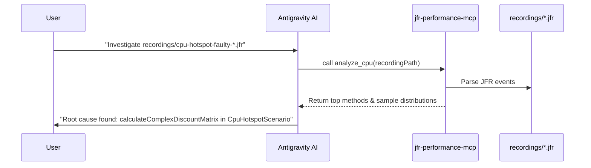

# ShopSphere — JVM Performance & JFR Demonstration Application

[](https://openjdk.org/projects/jdk/21/)
[](https://spring.io/projects/spring-boot)
[](https://docs.oracle.com/en/java/javase/21/jfapi/index.html)

**ShopSphere** is a realistic e-commerce order and inventory service built in Java 21 and Spring Boot. It is specifically crafted for demonstrating production JVM performance investigations using **Java Flight Recorder (JFR)**, **JDK Mission Control (JMC)**, the **Java MCP SDK**, and **Google Antigravity AI**.

This repository is the companion project for the conference session:
> **Give Your JVM an AI Assistant: JFR, JDK Mission Control and MCP for Production Performance**

---

## 1. Architecture

```mermaid
graph TD
    subgraph ShopSphere Application
        API[REST API Endpoints\n/api/orders, /api/inventory, /api/scenarios]
        Registry[Scenario Registry]
        BaseScenario[Scenario Engine\nBounded Pools, Timeouts, Latency Trackers]
        JFRHelper[JFR Recording Helper\njdk.jfr.Recording]
        Metrics[Micrometer & Actuator\n/api/metrics/summary]
    end

    subgraph Investigation & AI Workflow
        JFRFile[Genuine JFR Binary File\nrecordings/*.jfr]
        JMC[JDK Mission Control UI]
        MCP[jfr-performance-mcp\n(MCP Server)]
        Antigravity[Antigravity AI Agent\n(Pair Programmer)]
    end

    API --> Registry
    Registry --> BaseScenario
    BaseScenario --> JFRHelper
    JFRHelper --> JFRFile
    BaseScenario --> Metrics

    JFRFile --> JMC
    JFRFile --> MCP
    MCP --> Antigravity
    Antigravity -.->|Source Code Root Cause & Fix| BaseScenario
```

---

## 2. Key Features

- **10 Realistic JVM Performance Scenarios:** Each reproduces a specific JVM pathology with genuine JFR event signatures and a corresponding corrected implementation.
- **Genuine JVM Runtime Evidence:** No mock metrics or fabricated JFR events. Every run executes real bytecode, real memory allocation, and real monitor contention.
- **Deterministic Workload Generator:** Built-in multi-threaded load generator with warm-up phases, measurement intervals, and HdrHistogram latency percentiles (P50, P95, P99).
- **Before-and-After Comparison Tool:** Automatically calculates throughput deltas, latency improvements, verifies workload comparability, and outputs clean Markdown reports.
- **In-Process & External JFR Capture:** Supports automated recording via `JfrRecordingHelper` as well as standard external `jcmd <PID> JFR.start / JFR.dump`.
- **Zero External Dependencies:** Runs purely locally on developer workstations without databases, Kafka, Redis, or cloud services.

---

## 3. Scenario Catalog

| ID | Name | Description | Dominant JFR Event |
| :--- | :--- | :--- | :--- |
| `cpu-hotspot` | **CPU Hotspot** | Redundant polynomial discount calculations in pricing | `jdk.ExecutionSample` |
| `thread-contention` | **Thread Contention** | Coarse synchronized monitor on shared inventory | `jdk.JavaMonitorEnter` |
| `allocation-pressure` | **Allocation Pressure** | Heavy string & intermediate map allocations in summaries | `jdk.ObjectAllocationSample` |
| `gc-pressure` | **GC Pressure** | High allocation churn triggering frequent young-gen collections | `jdk.GarbageCollection` |
| `thread-pool-starvation` | **Thread Pool Starvation** | Undersized worker pool causing queue buildup | `jdk.ThreadPark` |
| `slow-io` | **Slow Downstream I/O** | Latency caused by waiting on downstream partner APIs | `jdk.ThreadPark` (Low CPU) |
| `exception-storm` | **Exception Storm** | Using exceptions for normal business validation control flow | `jdk.JavaExceptionThrow` |
| `serialization-overhead` | **Serialization Overhead** | Multiple Jackson JSON roundtrips during response building | `jdk.ExecutionSample` / Alloc |
| `lock-and-io` | **Lock Scope with I/O** | Holding shared lock while awaiting downstream network calls | `jdk.JavaMonitorEnter` + I/O |
| `jvm-configuration` | **JVM Sizing Comparison** | Memory pool occupancy and GC behavior under varying heap sizes | JVM Flags / Memory MXBean |

See [`docs/scenarios.md`](file:///home/rsoni/git/jfr-performance-demo-app/docs/scenarios.md) for full details on each scenario.

---

## 4. Prerequisites

- **Java Development Kit (JDK):** Version 21 or newer (OpenJDK, Temurin, Oracle JDK).
- **Apache Maven:** Version 3.8+
- **JDK Mission Control (JMC):** Version 8.x or 9.x (for GUI inspection).

Verify installation:
```bash
java -version
mvn -version
```

---

## 5. Build Instructions

Build the application:
```bash
mvn clean package -DskipTests
```

Run tests:
```bash
mvn test
```

---

## 6. Execution Modes

### Mode A: Standalone Workload Runner with JFR (Recommended for Demos)
Run a complete benchmark with automated JFR capture:
```bash
# Run CPU Hotspot Demo (Faulty vs Corrected + Before/After Comparison)
./scripts/run-demo.sh cpu-hotspot 15 8

# Run Thread Contention Demo
./scripts/run-demo.sh thread-contention 15 8

# Run Allocation Pressure Demo
./scripts/run-demo.sh allocation-pressure 15 8
```

### Mode B: Interactive Spring Boot Server
Start the HTTP server on port 8080:
```bash
java -jar target/jfr-performance-demo-app-1.0.0-SNAPSHOT.jar
```

Exposed REST API Endpoints:
- `GET  /api/products` — Catalog items
- `POST /api/orders/calculate-price` — Calculate order prices
- `POST /api/inventory/reserve` — Reserve stock
- `GET  /api/scenarios` — List all 10 scenarios and status
- `POST /api/scenarios/{id}/start?mode=FAULTY&durationSeconds=20&concurrency=8` — Start scenario
- `POST /api/scenarios/{id}/stop` — Stop running scenario
- `GET  /api/metrics/summary` — Real-time JVM memory & scenario latency percentiles
- `POST /api/jfr/start?scenarioId=cpu-hotspot&mode=faulty` — Start in-process JFR recording
- `POST /api/jfr/stop` — Stop and dump JFR recording
- `GET  /actuator/health` — Application health

---

## 7. External JFR Capture via `jcmd`

If running the application server, you can capture JFR recordings externally using standard JDK tooling:

```bash
# 1. Find the application PID
jcmd

# 2. Start JFR recording with profiling preset
jcmd <PID> JFR.start name=cpu-run settings=profile duration=30s filename=recordings/cpu-external.jfr

# 3. Check recording status
jcmd <PID> JFR.check

# 4. Dump recording manually if needed
jcmd <PID> JFR.dump name=cpu-run filename=recordings/cpu-external.jfr
```

---

## 8. Analyzing with JDK Mission Control (JMC)

1. Launch **JDK Mission Control (`jmc`)**.
2. Open the recording from `recordings/<scenario>-<mode>-<timestamp>.jfr`.
3. For CPU Hotspot: Open **Method Profiling** -> **Hot Methods** and observe top sampled application methods.
4. For Thread Contention: Open **Threads** -> **Lock Instances** / **Contention** and observe lock wait durations on `InventoryService.globalMonitor`.
5. For Allocation Churn: Open **Memory** -> **Allocations** and inspect allocation stack traces.

---

## 9. Antigravity AI & MCP Server Integration

Connect Antigravity to the `jfr-performance-mcp` server to automate recording analysis:



### Sample Antigravity Prompts:
- **CPU Hotspot:** `"Analyze recordings/cpu-hotspot-faulty-<timestamp>.jfr using JFR MCP tools. Identify the dominant CPU methods, distinguish sample percentages from exact time, and locate the source code bottleneck."`
- **Thread Contention:** `"Analyze recordings/thread-contention-faulty-<timestamp>.jfr. Find evidence of monitor contention, identify the locked resource, and recommend a thread-safe fix."`
- **Before/After Validation:** `"Compare results/cpu-hotspot-faulty.json with results/cpu-hotspot-corrected.json. Summarize throughput and latency improvements."`

See [`docs/antigravity-demo.md`](file:///home/rsoni/git/jfr-performance-demo-app/docs/antigravity-demo.md) for full walkthroughs.

---

## 10. Safety and Bounded Workload Guarantees

The application is built with strict safety boundaries:
- **Bounded Concurrency:** Worker pools capped at a maximum of 50 threads.
- **Bounded Duration:** Scenario execution strictly capped (default 20s, maximum 120s).
- **Graceful Cancellation:** Thread interrupts and atomic flags ensure immediate cancellation via `/api/scenarios/{id}/stop` or `scenario.stop()`.
- **Heap Safety:** Workloads do not create unbounded static collections or memory leaks.

---

## 11. Project Structure

```
jfr-performance-demo-app/
├── pom.xml
├── README.md
├── docs/
│   ├── scenarios.md
│   ├── antigravity-demo.md
│   └── jfr-events-guide.md
├── scripts/
│   ├── run-demo.sh
│   ├── record-scenario.sh
│   ├── compare-runs.sh
│   └── generate-all-recordings.sh
├── src/
│   ├── main/
│   │   ├── java/com/shopsphere/demo/
│   │   │   ├── ShopSphereApplication.java
│   │   │   ├── domain/
│   │   │   ├── service/
│   │   │   ├── controller/
│   │   │   ├── scenario/
│   │   │   │   ├── Scenario.java, BaseScenario.java, ScenarioRegistry.java
│   │   │   │   ├── cpu/CpuHotspotScenario.java
│   │   │   │   ├── contention/ThreadContentionScenario.java, LockAndIoScenario.java
│   │   │   │   ├── allocation/AllocationPressureScenario.java, GcPressureScenario.java
│   │   │   │   ├── threadpool/ThreadPoolStarvationScenario.java
│   │   │   │   ├── io/SlowIoScenario.java
│   │   │   │   ├── exception/ExceptionStormScenario.java
│   │   │   │   ├── serialization/SerializationOverheadScenario.java
│   │   │   │   └── jvm/JvmConfigurationScenario.java
│   │   │   ├── workload/
│   │   │   ├── comparison/
│   │   │   └── jfr/
│   │   └── resources/
│   │       ├── application.yml
│   │       └── logback-spring.xml
│   └── test/
└── recordings/
```
